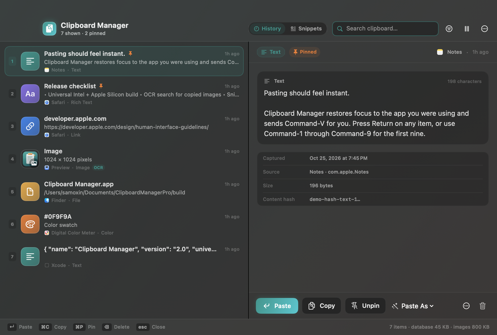
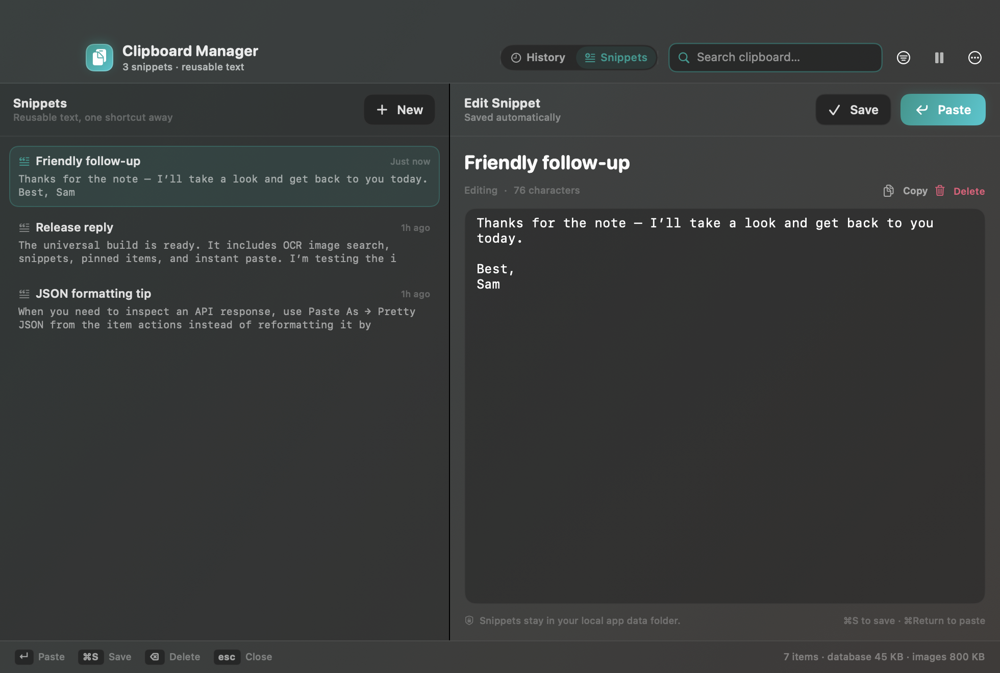

# Clipboard Manager

A local-first clipboard manager for macOS. It keeps text, rich text, links, images, colors, and files within reach, with OCR-powered image search, snippets, text transforms, and automatic paste.

No account, no cloud, no telemetry. Everything stays on this Mac.



## Features

- Clipboard history for text, rich text, links, images, files, and colors
- Pinned items that survive trimming and cleanup
- Source-app filtering and full-history search
- OCR for copied images using Apple's on-device Vision framework
- Paste as plain text or transform text before pasting: uppercase, lowercase, title case, trimmed, pretty/minified JSON, URL encode/decode, Base64 encode/decode
- Reusable snippets with automatic saving and quick paste
- Automatic paste: restores the previous app and sends Command-V
- Global shortcut, configurable in Settings
- Maximum-history and retention limits
- Skip concealed or auto-generated clipboard content
- Pause clipboard monitoring from the menu bar
- JSON backup export/import, including images and snippets
- Launch at login support
- Menu-bar utility with no Dock icon



## Install

1. Open [ClipboardManager-2.0-universal.dmg](build/ClipboardManager-2.0-universal.dmg).
2. Drag **Clipboard Manager.app** into **Applications**.
3. Launch the app. It appears in the menu bar.
4. Open **System Settings → Privacy & Security → Accessibility** and enable **Clipboard Manager** for automatic paste.

Manual copy and browsing work without Accessibility permission. Auto-paste is the only feature that requires it.

The build is ad-hoc signed and not notarized. If macOS blocks the downloaded copy, right-click the app, choose **Open**, and confirm. This is a local build; it does not include an auto-updater.

## Usage

Open the history panel with **Control + backtick** or the menu-bar icon.

| Action | Shortcut |
| --- | --- |
| Open clipboard history | <kbd>Control</kbd> + <kbd>`</kbd> |
| Open snippets | `Cmd` + `Shift` + `S` |
| Paste selected item | `Return` |
| Copy selected item | `Cmd` + `C` |
| Pin or unpin | `Cmd` + `P` |
| Delete selected item | `Delete` |
| Quick-paste first nine items | `Cmd` + `1` … `Cmd` + `9` |
| Focus search | `Cmd` + `F` |
| Close panel | `Esc` |

In snippets mode, `Cmd + S` saves the current draft and `Cmd + Return` pastes it. Return inside the snippet editor inserts a newline.

## Data and privacy

Clipboard history and images are stored locally at:

```text
~/Library/Application Support/Clipboard Manager Pro/
```

The folder contains `history.sqlite` and an `Images/` directory. Delete the folder to reset the app. The app does not import data from the older `ClipboardManager` bundle.

Backups are manual JSON archives created from **Settings → Data → Export**. OCR runs on-device through Vision. No clipboard content is uploaded.

## Build from source

Requirements:

- macOS 14 or newer
- Xcode Command Line Tools
- Swift toolchain provided by `xcrun`

Build the universal app:

```sh
./build.sh
```

The result is `build/Clipboard Manager.app`, targeting both `x86_64` and `arm64`.

Build the DMG:

```sh
./make_dmg.sh
```

The result is `build/ClipboardManager-2.0-universal.dmg`.

`make_dmg.sh` uses `dmgbuild` when it is available for a Finder-free, reproducible layout. Otherwise it falls back to arranging the disk-image window with Finder.

## Project layout

```text
Sources/          Swift app: models, database, clipboard monitor, OCR, paste, UI
Resources/        App icon, icon set, and DMG background
scripts/          Icon/DMG asset generators and dmgbuild settings
build/            Built app, universal DMG, and UI previews
Info.plist        Bundle metadata
build.sh          Universal release build and ad-hoc signing
make_dmg.sh       DMG creation and verification
```

## Status

Version 2.0 (build 2). Tested locally on Intel macOS 26. Universal build is produced for Intel and Apple Silicon. The project is a local-first utility, not an App Store distribution.
